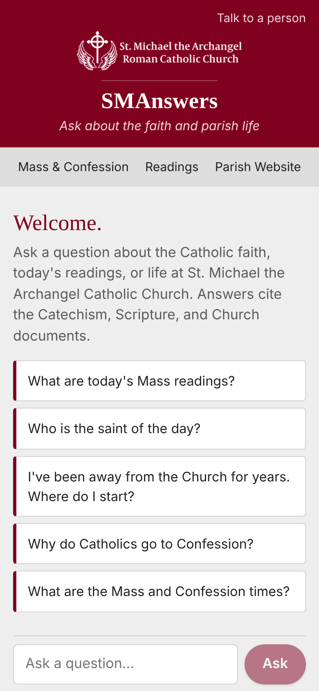

# SMAnswers

A mobile-friendly Q&A site for St. Michael's parishioners. People ask about the Catholic faith, today's readings, the saint of the day, or parish life. Answers come from Claude, which looks things up with Magisterium's search API and cites the Catechism, Scripture, and Church documents.



## How it works

- **`src/app/api/chat/route.ts`**: the only server code. It sends the conversation to the Claude API, runs the Magisterium searches Claude asks for, and streams the answer back to the browser. API keys stay on the server.
- **`src/lib/magisterium.ts`**: the `magisterium_search` tool, which calls `https://www.magisterium.com/api/v1/search` with the Magisterium API key. (Magisterium's hosted MCP server only supports an interactive OAuth login, which a server-side app can't complete.)
- **`src/lib/systemPrompt.ts`**: SMAnswers' instructions. It covers voice, citation rules, when to hand off to a priest or the parish office (personal sacramental eligibility, marriage and annulment questions, specific sins, Confession), and crisis and abuse-disclosure safety rules.
- **`src/config/parish.ts`**: parish details (Mass and Confession times, office contacts, ministries). Most details were gathered from saintmichaelcc.org in October 2026; anything still in `[brackets]` is unfilled, and SMAnswers tells people to contact the office instead of guessing.
- **`src/components/Chat.tsx`**: the chat page, with starter questions, a "Talk to a person" panel, and a disclaimer.

## Run it locally

```bash
cp .env.example .env.local   # then fill in the keys
npm install
npm run dev                  # http://localhost:3000
```

## Deploy on Vercel

1. In Vercel, **Add New → Project** and import this GitHub repository. The defaults are correct for Next.js.
2. Under **Settings → Environment Variables**, add:
   - `ANTHROPIC_API_KEY`: from [console.anthropic.com](https://console.anthropic.com). API usage is billed per use, separately from any Claude.ai subscription.
   - `MAGISTERIUM_API_KEY`: your Magisterium developer API key. (`MAGISTERIUM_MCP_TOKEN` also works.)
3. Deploy, then share the link (or a QR code for the bulletin).

Optional settings: `ANTHROPIC_MODEL` (default `claude-opus-5-5`), `SMA_EFFORT` (`low`, `medium` or `high`; default `medium`), `SMA_RATE_LIMIT` (questions per visitor per 10 minutes; default 20), and `MAGISTERIUM_API_URL`.

## Keeping costs in check

This is a public page that spends API credit, so:

- Set a **monthly spend limit** in the Anthropic Console. This is the real safety net.
- Each visitor is limited to `SMA_RATE_LIMIT` questions per 10 minutes. The limiter is per server instance, so it's a speed bump, not a hard cap.
- Questions are capped at 2,000 characters and conversations at 20 messages.
- To lower the per-question cost, try `SMA_EFFORT=low`, or set `ANTHROPIC_MODEL=claude-sonnet-5-5`, and check that answer quality holds.

## Before launch

- [ ] Confirm the details in `src/config/parish.ts` (especially Mass and Confession times) and fill the remaining `[placeholders]`: office email and Returning Catholics meeting time.
- [ ] Have the Director of Faith Formation (and the pastor, as appropriate) review the instructions in `src/lib/systemPrompt.ts` and try the app.
- [ ] Ask a set of test questions, including hand-off cases (Communion after remarriage, "is this a mortal sin?"), and check the citations against the sources.
- [ ] Set the Anthropic Console spend limit.
